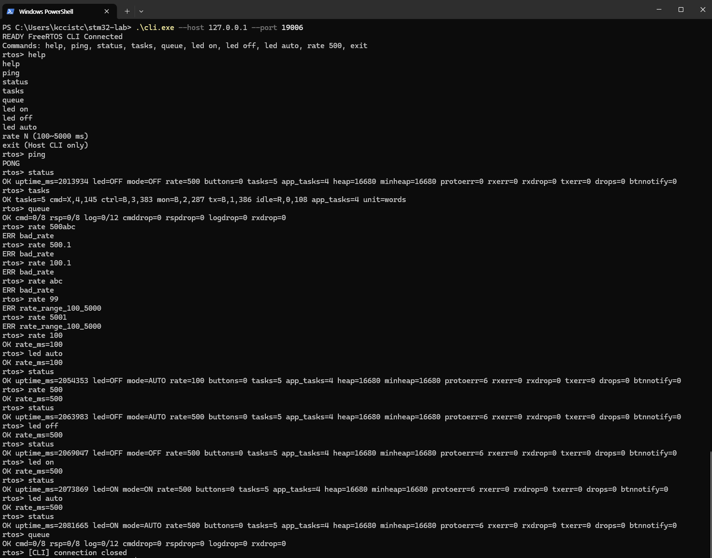

# 구현·검증 기록

## 현재 결과 — 2026-10-30

HELP·Rate 파서와 애플리케이션 설정을 정리한 수정본에서 ARM·Windows 빌드, Linux 3개·Windows 5개 자동 테스트를 통과했습니다. NUCLEO-F411RE에 펌웨어를 기록한 뒤 UART 명령, LED AUTO, 버튼 이벤트와 두 CLI의 교차 제어·조회 동작을 확인했습니다.

| 항목 | 수정본 결과 |
|---|---|
| ARM Debug / Windows Monitor·CLI 빌드 | PASS |
| Linux / Windows CTest | 3/3 / 5/5 PASS |
| Rate / Firmware Dispatch·HELP | 31개 사례 / 386 checks |
| Protocol / Windows bridge / CLI 표시 | 40 / 34 / 6 checks |
| Flash / 링크 RAM | 32,132 / 36,680 bytes |
| 보드 조회 Free Heap / Minimum Heap | 16,680 / 16,680 bytes |
| 보드 기능 확인 | Task 4개+Idle, UART, HELP·Rate, LED ON/OFF/AUTO, 버튼, 두 CLI |

[README](README.md)에는 시스템 구조와 실행 방법을, 아래에는 초기 구현부터 수정본의 시험 근거까지 기록했습니다.

## 1. 대상 버전과 시험 기록

공개 소스 기준은 [`fc304910863ce8ca7e118fd3b41b54d58dd872d4`](https://github.com/triton0305/freertos-stm32-lab/commit/fc304910863ce8ca7e118fd3b41b54d58dd872d4)입니다. 문서·이미지 정리에서는 해당 구현과 테스트·빌드 설정을 유지했습니다.

| 날짜 | 기록 | 환경·대상 | 근거 |
|---|---|---|---|
| 2026-10-29 | 초기 구현·검증 | ARM GCC 10.3.1, Linux GCC 11.4.0, MinGW GNU 10.0.0 / 초기 빌드 | 최초 `IMPLEMENTATION_REPORT.md`의 실행 결과 요약 |
| 2026-10-30 | 수정·회귀 검증 | HELP·Rate·설정 중앙화를 반영한 펌웨어와 Windows Host | 수정본 빌드·테스트 결과 기록 |
| 2026-10-30 | CLI·보드 실습 | NUCLEO-F411RE, ST-LINK VCP COM7, UART 115200 8N1 | [CLI 회귀 검증 사진](docs/assets/cli_regression.png), [두 CLI 사진](docs/assets/two_cli.png), [버튼·Monitor 사진](docs/assets/button_monitor.png) |
| 2026-10-30 | Timing 측정 | Windows QPC 수신 시각 / 수정본 UART timestamp | 15초 관찰 시험에서 기록한 LED·STATUS 측정 요약 |
| 2026-10-30 | 보조 소스 검토 | 별도 Linux 환경, GCC 직접 빌드 | Protocol 40·Dispatch 386 checks 및 10초 Timing 시험 통과 기록 |

초기·수정본의 binary 정보는 각 빌드 기록에 대응합니다. 수정본의 BIN 해시는 확보한 기록에 포함되지 않아 초기 해시를 초기 빌드 절에만 보존했습니다. 원시 `build/*.log`는 당시 로컬 빌드 디렉터리의 기록이며, 이 문서에는 실행 결과 요약과 제공된 사진을 남겼습니다.

명세는 [01 · 구현·검증 요구사항](<docs/specs/01_first_spec_(implementation_validation).md>), [02 · 관련 Yocto 이미지 요구사항](<docs/specs/02_second_spec_(yocto_uart_gpio8_image).md>), [03 · 문서 정리 기준](<docs/specs/03_third_spec_(STM32_FreeRTOS_GitHub_Final).md>)으로 구분했습니다. 01번은 초기 설계 요구사항, 02번은 별도 Raspberry Pi 프로젝트 문서, 03번은 이번 공개 문서 정리 기준입니다.

## 2. 초기 구현·검증 — 2026-10-29

이 절의 수치와 시험 상태는 초기 빌드 시점의 기록입니다.

### 2.1 구현 중 해결한 문제

| 문제·설계 항목 | 반영한 내용 |
|---|---|
| HAL UART의 `DMA_HandleTypeDef` 컴파일 오류 | HAL DMA 설정·헤더 의존성 추가. 통신은 기존 IRQ RX·polling TX 구성 유지 |
| B1 입력 극성 | PC13 active-low 적용, 양 edge 알림과 Task의 50ms 안정화, 안정된 해제 후 재무장 |
| AUTO 시간 처리 | 진입 시 OFF·첫 deadline 정의, 절대 deadline 유지, 지난 slot 건너뛰기, wrap-safe 연산 |
| UART 송신과 Task 실행 | Monitor 우선순위를 TX보다 높게 설정, Command RX 64byte마다 1ms 양보, 과거 STAT burst 방지 |
| UART 유실 후 복구 | unread backlog와 다음 LF까지 폐기, HAL TX timeout 뒤 RX IRQ 재활성화 |
| 진단 통계 | 최소 Heap, protocol·button notification, Idle 상태·watermark, 320byte TX frame |
| 여러 CLI의 요청 | local ID→global UART ID→원래 local ID 복원, ID wrap·collision 회피 |
| Host 수명주기 | slow client 분리, boot 시 pending 정리, CLI 입력·수신 분리와 Monitor 종료 감지 |
| 시간 관찰 | QPC·Linux monotonic 측정, interval 평균/min/max·drift·누적 오차 출력 |
| 빌드 재현 | 공식 의존성 4개 커밋 고정·변경 검사, WSL MinGW bootstrap |

### 2.2 빌드 결과

ARM ELF/BIN/MAP 생성과 링크를 확인했습니다. ELF에서 SVC/PendSV/SysTick/TIM5 strong handler가 각각 하나씩 정의된 것을 확인했습니다. 공식 의존성 4개의 실제 HEAD와 tracked 수정 여부를 검사했습니다.

- ARM GCC 10.3.1 configure/build/link 성공.
- MinGW GNU 10.0.0으로 Monitor·CLI와 Windows 테스트 EXE 빌드 성공.
- Linux GCC 11.4.0으로 Host 테스트 빌드 성공.
- 최초 ARM 컴파일의 DMA 헤더 오류는 의존성 수정 후 해결했습니다.
- 최초 전체 HAL 빌드에서 `flash_ex`의 미사용 Banks 인자 경고 3개가 있었고, 자체 소스 최종 빌드는 경고 없이 확인했습니다.
- MinGW는 사용자 디렉터리에 Ubuntu 패키지를 추출하는 방식으로도 빌드를 확인했습니다.
- 잘못된 `FREERTOS_KERNEL_SOURCE_DIR`를 넣었을 때 expected/actual commit을 출력하고 configure가 exit 1로 종료되는 것을 확인했습니다.

### 2.3 초기 테스트

| 시험 | 초기 결과 | 확인 내용 |
|---|---|---|
| Linux CTest | 3/3 PASS | Protocol, monotonic·deadline·debounce, Dispatch doubles |
| Windows CTest / WSL Interop | 4/4 PASS | Linux와 공통 시험 + Winsock TCP/mock UART bridge |
| Protocol | 29 checks / 양 플랫폼 | 부분 수신, ID·byte 검사, overflow 복구, normalize, wrap·skew |
| Firmware Dispatch | 20 checks / 양 플랫폼 | Queue full·회복, RSP·Log drop, Rate·상태 |
| Windows bridge | 30 checks | 두 client의 같은 local ID, 역순 응답, global ID wrap·collision, timeout·reset·재접속·slow client |
| Monitor·CLI 별도 process | PASS | Mock PING/PONG, mock STATUS 오류, CLI exit 후 Monitor 유지 |
| Idle CLI의 연결 종료 | PASS | 입력을 기다리는 CLI의 Monitor 종료 감지, 제한 시간 내 exit 0 |
| COM999 실패 처리 | 예상 실패 확인 | CreateFile Win32 error 2, exit 1 |
| COM7 열기·수신 | Host 연결 확인 | 당시 보드의 기존 펌웨어 ASCII 데이터 수신 |
| 의존성 핀 불일치 | 예상 실패 확인 | 다른 커밋을 configure 단계에서 거부 |

초기 COM7 시험은 `DOOR:OPEN`, `ESTOP:OFF`, `PRESSURE:...`가 출력되던 이전 Equipment Controller 펌웨어를 수신한 기록입니다. 새 Lab 펌웨어의 Flash와 보드 기능 확인은 4절의 수정본 실습 기록으로 이어집니다.

### 2.4 초기 메모리와 BIN

| 지표 | 초기 값 |
|---|---:|
| Flash | 31,980 bytes / 524,288 bytes (6.10%) |
| RAM | 36,680 bytes / 131,072 bytes (27.98%) |
| size text / data / bss | 31,796 / 144 / 36,544 bytes |
| BIN | 31,980 bytes |

초기 BIN SHA-256:

```text
03b4d53cc24589770142a632a39e6a4060f87de2615a0bdaa5d1d4d1256d15e6
```

RAM region에는 RTOS heap 배열 32KiB와 linker의 C heap·MSP reserve가 포함됩니다. Task stack·Queue는 RTOS heap에서 동적으로 할당합니다.

### 2.5 초기 Host 시간 시험

OS 단조 시계로 10초 이상 관찰하고, 1000씩 증가시킨 합성 MCU timestamp를 입력해 계산과 출력 형식을 확인했습니다.

| 플랫폼 | Host 경과 | 합성 MCU 경과 | MCU−Host | 평균 간격 | min / max |
|---|---:|---:|---:|---:|---:|
| Linux CLOCK_MONOTONIC | 10,000ms | 10,000ms | 0ms | 1000.000ms | 1000 / 1000ms |
| Windows QPC | 10,001ms | 10,000ms | −1ms | 1000.100ms | 993 / 1014ms |

같은 시험에서 deadline wrap·skipped slot, debounce 재무장·긴 누름, timestamp reset·wrap 구분을 확인했습니다. 보드의 실제 timestamp 비교값은 4.4절에 정리했습니다.

## 3. 수정·회귀 검증 — 2026-10-30

### 3.1 변경 내용

| 항목 | 수정 내용 |
|---|---|
| HELP | `led_on` 등 잘못된 하드코딩 문법을 실제 `led on`으로 수정 |
| HELP transport·표시 | UART에서는 단일 RSP, CLI에서는 명령별 줄바꿈. `exit`는 Host CLI 표시 |
| Rate 파서 | 숫자 형식 오류·uint32 오버플로는 `bad_rate`, 정수 범위 초과는 `rate_range_100_5000` |
| 설정 중앙화 | `App/app_config.h`로 우선순위·Stack·Queue·버퍼·시간 설정을 이동하고 단위·컴파일 타임 검사 추가 |
| 회귀 테스트 | Rate 31개 사례, 오류 후 상태 유지·PING/STATUS 회복, HELP 라우팅·표시 및 STAT/EVT 혼합 추가 |

Task 우선순위, Queue·Stack 크기, Timing·ISR·Mutex 정책 값은 유지했습니다. 커널 설정은 `FreeRTOSConfig.h`, 주변장치는 Board, Windows COM·TCP 옵션은 Host 계층에 남겼습니다.

### 3.2 실행 결과

| 항목 | 수정본 결과 |
|---|---|
| ARM Debug / Windows Monitor·CLI 빌드 | PASS |
| Linux CTest | 3/3 PASS |
| Windows CTest | 5/5 PASS |
| Rate 입력 | 31개 사례 PASS |
| Firmware Dispatch·HELP | 386 checks PASS |
| Host Protocol | 40 checks PASS |
| Windows 다중 CLI bridge | 34 checks PASS |
| Windows CLI 표시 | 6 checks PASS |

Firmware 시험은 실제 `Dispatch`를 포함하고 Queue·Mutex double로 포화·복구·상태를 검사합니다. Windows bridge 시험은 실제 Winsock loopback과 mock UART를 사용합니다. CLI 표시 시험은 실제 출력 함수를 호출해 HELP 줄바꿈과 응답 표시를 검사합니다. fake 헤더는 Host firmware 시험에만 연결하고 ARM 빌드에는 공식 FreeRTOS를 사용했습니다.

추가 시험 최초 실행에서 확인된 Queue 초기화 누락은 테스트 초기화 수정 후 재검증했습니다. 수정 전 소스 사본과 diff를 비교했고 공백 오류를 확인했습니다.

별도 Linux 소스 검토에서는 GCC로 Protocol·Firmware·Timing 테스트를 직접 빌드·실행했습니다. Protocol 40 checks, Dispatch 386 checks/Rate 31개와 10초 Timing 시험이 통과했습니다. 이때 10개 간격의 Host 경과는 10,000ms, 평균 1000.000ms, min/max 999/1001ms였습니다. 이 기록은 직접 실행한 세 시험의 결과로 보관하며, CTest 실행 결과와 구분합니다.

### 3.3 메모리 변화

| 지표 | 초기 | 수정본 | 차이 |
|---|---:|---:|---:|
| Flash | 31,980 bytes | 32,132 bytes | +152 bytes |
| RAM | 36,680 bytes | 36,680 bytes | 동일 |

## 4. 수정본 실장비 확인 — 2026-10-30

### 4.1 Flash와 실행 환경

STM32CubeProgrammer로 수정 펌웨어를 기록해 Download Verify와 MCU Software Reset을 확인했습니다. 보드에서 FreeRTOS Task와 UART 통신을 실행했습니다.

- 보드: NUCLEO-F411RE, LD2 PA5, B1 PC13.
- Monitor: WSL2 Ubuntu 터미널에서 Windows EXE를 Interop으로 실행.
- CLI: Windows PowerShell, Monitor의 TCP `127.0.0.1:19006`에 연결.
- 통신: Windows COM7 / ST-LINK VCP / USART2 115200 8N1.
- 구성: Application Task 4개, Idle 포함 5개, 우선순위 4/3/2/1/0.

### 4.2 수정본 CLI·펌웨어 회귀 검증

HELP·PING·상태 조회 후 오류 Rate 여섯 개와 정상 Rate·LED 제어를 순서대로 입력했습니다. 사진에 표시된 HELP는 명령마다 줄을 바꾸고 실제 CLI 문법을 유지합니다.

| 입력 | 응답·관찰 |
|---|---|
| `rate 500abc`, `rate 500.1`, `rate 100.1`, `rate abc` | `ERR bad_rate` |
| `rate 99`, `rate 5001` | `ERR rate_range_100_5000` |
| `rate 100`, `led auto`, `status` | `mode=AUTO rate=100` |
| `rate 500`, `status` | `mode=AUTO rate=500` |
| `led off`, `status` | `led=OFF mode=OFF` |
| `led on`, `status` | `led=ON mode=ON` |
| `led auto`, `status`, `queue` | AUTO 상태 조회, Queue drop 0 |

오류 여섯 개를 입력한 뒤 `protoerr`가 0에서 6으로 증가했고, 이어진 정상 제어·STATUS 조회가 처리됐습니다. 사진의 PING은 오류 입력 전에 수행한 통신 확인입니다. 오류 후 PING/STATUS 회복은 자동 회귀 시험과 실습 요약에도 기록했습니다.

사진 속 첫 Task 조회는 `cmd=X,4,145 ctrl=B,3,383 mon=B,2,287 tx=B,1,386 idle=R,0,108`입니다. 마지막 값은 각 Task의 최소 잔여 Stack words입니다. 당시 Free Heap과 Minimum Heap은 모두 16,680 bytes였습니다.



전체 입력 순서:

```text
help
ping
status
tasks
queue
rate 500abc
rate 500.1
rate 100.1
rate abc
rate 99
rate 5001
rate 100
led auto
status
rate 500
status
led off
status
led on
status
led auto
status
queue
```

### 4.3 두 CLI와 버튼 이벤트

[두 CLI 사진](docs/assets/two_cli.png)에서는 두 PowerShell 세션의 PONG과 각각의 조회를 확인했습니다. 위쪽 CLI의 `led off` 이후 아래쪽 CLI의 STATUS에도 `led=OFF mode=OFF`가 반영됐습니다. 사진의 상태는 `buttons=3 btnnotify=8`, UART RX/TX 오류·drop 0입니다.

[버튼·Monitor 사진](docs/assets/button_monitor.png)에서는 `buttons=6` 상태에서 버튼 이벤트 count 7과 8을 수신하고 STATUS가 7, 8로 갱신됐습니다. 이 장면의 `rxerr`, `drops`, `missed`는 0입니다. 화면의 Timing은 3개 간격·Host 2,954ms의 관찰 창입니다.

별도 버튼 실습 기록에는 `buttons` 0→1→2와 `btnnotify` 0→2→6이 남아 있습니다. `buttons`는 debounce를 거쳐 확정된 입력 수, `btnnotify`는 누적 ISR 알림 수로 구분했습니다. 소스는 양 edge EXTI와 50ms 안정화·해제 후 재무장을 사용합니다.

### 4.4 LED·STATUS Timing

LED AUTO 500ms 설정과 STATUS 1000ms 주기를 각각 고정한 상태에서 Windows QPC와 프레임의 MCU timestamp를 비교했습니다. 아래 값은 별도 15초 관찰 실습의 측정 요약입니다.

| 대상 | 설정 간격 | Host 평균 | 간격 수 | Host 경과 | MCU 경과 | MCU−Host |
|---|---:|---:|---:|---:|---:|---:|
| LED AUTO 이벤트 | 500ms | 494.200ms | 30 | 14,826ms | 15,000ms | +174ms |
| STATUS | 1000ms | 989.786ms | 14 | 13,857ms | 14,000ms | +143ms |

`host_elapsed_ms`는 QPC 기반 수신 시각 차이, `mcu_elapsed_ms`는 프레임 timestamp 차이입니다. `drift_ms`는 MCU−Host이고 평균 간격은 Host 경과/간격 수입니다. 두 시간 기준에서 약 1% 차이를 관찰했고 원인은 별도 분석 과제로 남겼습니다. 버튼·Monitor 사진의 짧은 관찰 창과 이 측정 표는 서로 다른 기록입니다.

초기 실습에서는 동일 설정으로 Host 10초 이상, drift 절댓값 `max(300ms, Host 경과×3%)`, STATUS 평균 970~1030ms·각 간격 800~1200ms, LED 평균 오차 `max(30ms, 설정 간격×3%)`를 관찰 기준으로 정했습니다. 위 요약은 경과·평균·간격 수를 보존하며 개별 min/max 값은 제공된 원시 기록 확보 후 추가할 수 있습니다.

영상에서는 AUTO 토글 간격을 1000→500→100ms로 변경했습니다.

▶ [전체 동작 영상 — YouTube](https://youtu.be/3qcbrseBkAc)

## 5. 재현과 진단

빌드·Flash·Monitor·PowerShell CLI 실행의 기본 절차는 [README](README.md#빌드실행)에 모았습니다. 커널·의존성 핀은 현재 CMake 설정을 따릅니다.

보드의 동일 설정 Timing을 다시 기록할 때는 CLI에서 `rate 500`, `led auto`를 설정한 뒤 WSL Monitor를 15초 실행합니다. Monitor를 새로 실행하기 전 기존 프로세스를 종료해 COM7을 해제합니다.

```bash
./build/host-win/monitor.exe --serial COM7 --baud 115200 --duration-ms 15000 | tee build/hw-timing.log
```

LED 측정 창은 `EVT config` 또는 rate 변경으로 초기화됩니다. 따라서 실측 구간 중에는 설정을 유지하고 STATUS/LED의 간격 수, elapsed, 평균/min/max, drift와 오류·drop·missed를 함께 기록합니다.

| 진단 지표 | 의미 |
|---|---|
| `jitter_ms` | Monitor의 실제 실행 tick과 예정 release tick 차이 |
| `missed` | AUTO에서 건너뛴 토글 deadline 수 |
| `protoerr` | ERR 응답 생성 횟수 |
| `rxerr` / `rxdrop` / `txerr` | UART 수신 오류 / ring overflow / 송신 실패 |
| `cmddrop` / `rspdrop` / `logdrop` | 각 Queue의 enqueue 실패·드롭 |
| `heap` / `minheap` | 현재 / 최소 잔여 RTOS Heap bytes |
| `unit=words` | Task Stack watermark 단위; bytes 환산은 ×4 |

진단 통계는 각 조회 시점의 관측값입니다. `status`의 `drops`는 세 Queue drop 합계이고, 주기 STAT의 `drops`는 여기에 ring overflow를 더합니다. 원인 확인에는 `queue`와 UART 통계를 함께 사용합니다.

## 6. 기술적 제약과 추가 검증 과제

### 설계상 제약

- RSP는 Log보다 먼저 선택하고 포화 시 유한 시간만 대기합니다. 응답 timeout 이후에는 STATUS로 제어 결과를 확인합니다.
- MCU는 HSI 기반 클럭을 사용하고, Host 수신값에는 UART·USB·Windows·stdout 처리 지연이 반영됩니다.
- Fault hook은 인터럽트를 막고 정지합니다. 자동 복구가 필요한 환경에서는 watchdog과 출력 정책을 추가 설계합니다.
- 32-bit tick은 약 49.7일에 순환하고 deadline·reset 판정은 반 wrap 범위의 시간 차이를 전제로 합니다.
- Mock transport는 PING과 시험용 TIMEOUT을 제공하며, Host doubles는 Dispatch와 시간·프로토콜 로직 검증에 사용합니다.

### 추가 검증 과제

| 항목 | 다음 확인 내용 |
|---|---|
| Mutex Priority Inheritance | 강제 경합 상황의 Task 우선순위 변화 계측 |
| Queue Full | 보드에서 포화 주입, drop·응답 및 부하 제거 후 복구 |
| UART 장애 | ORE 강제 주입, ring overflow, USB 단절·재연결 |
| 장시간 실행 | 지속 부하의 Task·Heap·Stack·Timing 추적 |
| GPIO 파형 | 외부 계측기로 LED 전환 간격·지터 측정 |
| 재시작·Fault | B2 reset 초기 상태, fault·watchdog 복구 정책 |

현재 문서의 보드 성과는 4절의 기능 실습과 Timing 기록을 중심으로 정리했습니다.
