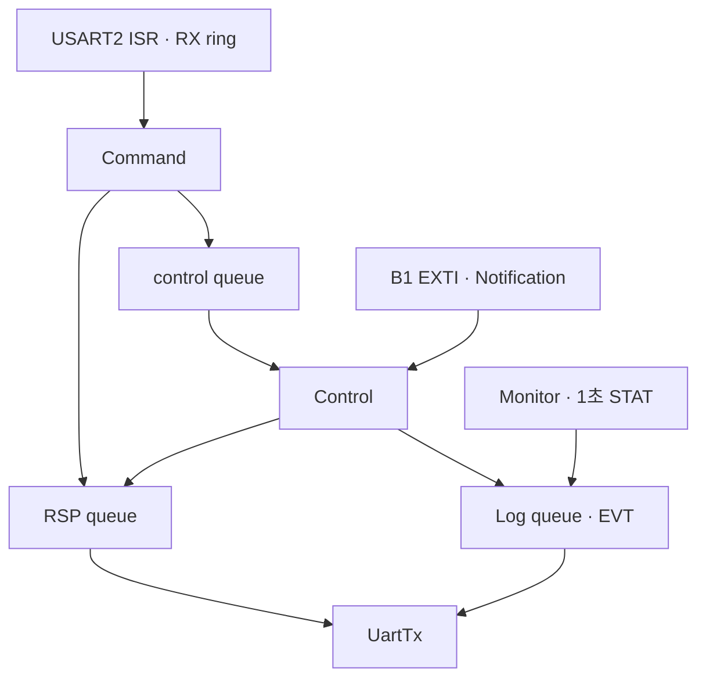
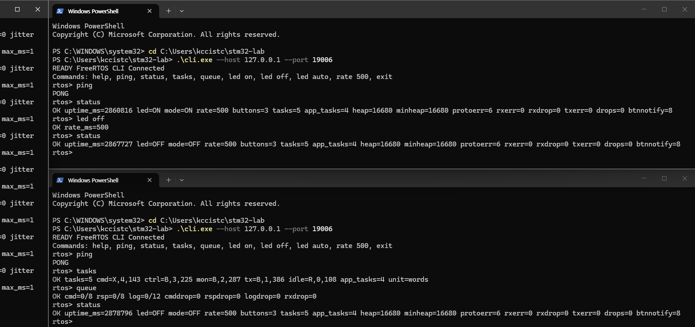
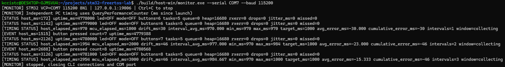

# STM32 FreeRTOS Lab

STM32F411RE에서 FreeRTOS 기반 LED 제어와 버튼 입력을 구현했습니다. 명령 처리, 제어, 상태 생성, UART 송신을 네 개의 Task로 분리하고 Queue, Mutex, Task Notification으로 연결했습니다. Windows Monitor·CLI를 통해 보드를 제어하고 Task 상태와 UART 이벤트, 주기 실행을 관찰했습니다.

**NUCLEO-F411RE / Cortex-M4F / C11 / FreeRTOS V11.3.1 / Queue · Mutex · Task Notification / UART · EXTI / Windows TCP Monitor · CLI**

## 프로젝트 명세

| 문서 | 내용 |
|---|---|
| [01 · 구현·검증 명세](<docs/specs/01_first_spec_(implementation_validation).md>) | 초기 펌웨어·Host 구현 요구사항과 검증 기준 |
| [02 · 리팩터링·회귀 검증 명세](<docs/specs/02_second_spec_(refactoring_regression).md>) | HELP·Rate 수정, 설정 중앙화와 회귀 검증 요구사항 |
| [03 · 포트폴리오 정리 명세](<docs/specs/03_third_spec_(STM32_FreeRTOS_GitHub_Final).md>) | README, 검증 기록, 시연 자료 및 GitHub 정리 기준 |

명세 원문과 현재 구현·검증 결과를 함께 보관했습니다. 현재 상태는 아래 본문과 [구현·검증 기록](IMPLEMENTATION_REPORT.md)에 정리했습니다.

## 핵심 구현과 성과

- **역할별 Task 4개:** Command(4), Control(3), Monitor(2), UartTx(1)로 분리했습니다.
- **명령·진단 경로 분리:** 제어 요청은 Queue로 전달하고, UART 응답(RSP)을 상태·이벤트(STAT/EVT)보다 우선 송신하도록 구성했습니다.
- **ISR와 공유 상태 처리:** UART·버튼 ISR은 Task에 알리고, `LabState`는 짧은 Mutex 구간에서 복사·갱신했습니다.
- **실장비 제어:** LED ON/OFF/AUTO, 토글 간격 변경, 버튼 이벤트, CLI 두 개의 교차 제어·상태 조회를 확인했습니다.
- **회귀 검증:** Linux 3개·Windows 5개 테스트를 통과하고, 수정본 보드에서 정상 명령과 오류 입력 후 상태를 확인했습니다.

## DEMO

AUTO 모드에서 토글 간격을 **1000 → 500 → 100ms**로 변경했습니다. `rate`는 LED가 ON↔OFF로 전환되는 간격이며, 1000ms 설정의 ON/OFF 한 주기는 2000ms입니다.

▶ [전체 동작 영상 — YouTube](https://youtu.be/3qcbrseBkAc)

## 시스템 구성

| 구성요소 | 실행·조작 위치 | 역할 |
|---|---|---|
| `cli.exe` | Windows PowerShell | 사용자 명령 입력, 요청 ID 관리, 응답 표시 |
| `monitor.exe` | WSL2 Ubuntu 터미널에서 WSL Interop으로 실행 | Windows COM 통신, TCP 요청 중계, 상태·이벤트 및 Timing 출력 |
| FreeRTOS 펌웨어 | NUCLEO-F411RE | Task 실행, LED·버튼·UART 처리 |

통신 경로는 **CLI ↔ TCP `127.0.0.1:19006` ↔ Monitor ↔ ST-LINK VCP ↔ STM32 USART2**입니다. Monitor와 CLI는 Windows 네이티브 프로그램이며, Monitor는 WSL 터미널에서 실행했습니다.

| 보드 설정 | 값 |
|---|---|
| MCU / 클럭 | STM32F411RET6 / HSI 16MHz → PLL 84MHz |
| UART | USART2, 115200 8N1, PA2 TX / PA3 RX |
| LED / 버튼 | LD2 PA5 / B1 PC13 active-low |
| RTOS / HAL 시간 기준 | SysTick 1000Hz / TIM5 1ms timebase |
| 검증 환경의 VCP | Windows COM7 |

## Task 구성과 설계

### Task와 데이터 흐름

| Task | Priority | Stack | 역할·대기 방식 |
|---|---:|---:|---|
| Command | 4 | 512 words | RX ring 소비, 명령 파싱·조회, 제어 요청 / RX Notification 최대 50ms 대기 |
| Control | 3 | 512 words | LED·상태 갱신, AUTO deadline, 버튼 처리 / control queue 최대 10ms 대기 |
| Monitor | 2 | 512 words | 1초 STAT 생성 / `vTaskDelayUntil` |
| UartTx | 1 | 512 words | UART 송신 전담 / log queue 최대 5ms 대기, 송신 timeout 40ms |
| Idle | 0 | 128 words | 커널 유휴 처리 |

Application Task는 4개, Idle 포함 총 5개입니다. Timer daemon은 비활성화했습니다. `tasks`의 `X/R/B/S`는 Running/Ready/Blocked/Suspended이며, Queue·Notification·주기를 기다리는 Task는 정상적으로 `B` 상태를 보입니다. Stack watermark는 최소 잔여 32-bit words로 표시합니다.



### 통신과 동기화

| 객체 | 용량 | 생산자 → 소비자 | 처리 정책 |
|---|---:|---|---|
| UART RX ring | 256byte 배열 / 255byte 유효 | ISR → Command | 수신 유실 시 backlog 폐기, 다음 LF까지 재동기화 |
| control queue | 8개 | Command → Control | 포화 시 `ERR control_queue_full`, `cmddrop` 증가 |
| RSP queue | 8 × 320byte | Command·Control → UartTx | 최대 20ms enqueue 대기, 포화 시 `rspdrop` 증가 |
| log queue | 12 × 320byte | Control·Monitor → UartTx | EVT·STAT FIFO, 포화 시 `logdrop` 증가 |
| state mutex | 1개 | Control 갱신 / Command·Monitor 조회 | `LabState` 복사·갱신 구간 보호 |

UART 송신을 UartTx에 집중해 Command와 Control이 직접 polling 송신을 수행하는 시간을 분리했습니다. UartTx는 RSP를 먼저 확인하며, 이미 진행 중인 Log 송신은 완료한 뒤 다음 프레임을 선택합니다. Monitor를 UartTx보다 높은 우선순위로 두고, Command는 RX 64byte마다 1ms 양보하도록 구성했습니다.

`LabState`는 Control이 갱신하고 Command·Monitor가 snapshot을 읽습니다. Mutex는 짧은 메모리 복사·갱신 동안 보유하며 UART 송신 전에 해제합니다. FreeRTOS Mutex의 Priority Inheritance 지원을 사용하도록 설정했습니다.

Monitor는 CLI별 local ID를 UART global ID로 바꾸고, 응답을 원래 CLI ID로 복원합니다. 최대 8개 CLI가 연결되며 client당 요청 1개를 처리합니다. Monitor 요청 timeout은 5초, CLI 응답 대기는 7초입니다. 연결 해제·재접속과 MCU boot 이벤트에 맞춰 pending 요청을 정리합니다.

UART는 LF 종료 ASCII 프레임을 사용합니다. 명령은 `CMD <id> ...`, 응답은 `RSP <id> OK/ERR ...`, 비동기 출력은 `STAT`·`EVT`로 구분했습니다. HELP도 UART에서는 한 줄로 전달하고 CLI에서 명령별 줄바꿈으로 표시합니다. 입력은 최대 127자, 출력은 최대 318자+LF이며 부분 수신과 긴 입력의 LF 복구를 처리합니다.

### 시간 제어와 설정 관리

AUTO 진입 시 LED를 OFF로 초기화하고 한 토글 간격 뒤 ON으로 전환합니다. 다음 deadline은 이전 목표 시점에서 증가시켜 phase를 유지하고, 실행이 늦어진 slot은 건너뛰어 `missed`로 집계합니다. `rate` 변경 시에는 현재 시점에서 새 deadline을 시작합니다.

Monitor는 `vTaskDelayUntil`로 1초 release를 유지하고, 전체 주기를 놓치면 지난 release를 건너뜁니다. uint32 tick 차이로 wraparound를 처리하며 uptime은 약 49.7일에 순환합니다. B1은 양 edge EXTI로 알리고 Control이 GPIO level의 50ms 안정화를 판정합니다. 안정된 해제 이후 다음 입력을 받도록 구성했습니다.

`App/app_config.h`에 Task 우선순위·Stack, Queue 깊이, UART 버퍼, LED 주기, debounce, 상태 주기, 대기·timeout을 모았습니다. 단위가 드러나는 이름과 컴파일 타임 검사로 설정 관계를 확인합니다. 커널 설정은 `Core/FreeRTOSConfig.h`, MCU 핀·클럭·주변장치는 `Core/board.c`, Windows COM·TCP 옵션은 Host 계층에서 관리합니다.

## 실행·검증 결과

### 두 CLI의 교차 제어와 상태 조회

PowerShell CLI 두 개에서 PING 응답과 STATUS/TASKS/QUEUE 조회를 확인했습니다. 위쪽 CLI에서 `led off`로 변경한 뒤 아래쪽 CLI에서도 `led=OFF mode=OFF`를 조회했습니다. 해당 화면에서 UART RX/TX 오류와 Queue drop은 0이었습니다.



### 버튼 입력과 Monitor 이벤트

B1 입력 후 `EVT button pressed`를 수신하고, 주기 STATUS의 `buttons`가 **6 → 7 → 8**로 증가하는 것을 확인했습니다. 아래 화면은 버튼 입력과 이벤트·상태 출력을 함께 기록한 장면입니다.



### 검증 요약

2026-10-30 수정본의 빌드·회귀 검증 기록과 보드 실습 결과입니다. 시험 환경과 초기 이력, CLI 회귀 검증 사진은 [구현·검증 기록](IMPLEMENTATION_REPORT.md)에 정리했습니다.

| 항목 | 결과 |
|---|---|
| ARM Debug / Windows Monitor·CLI 빌드 | PASS |
| Linux / Windows CTest | 3/3 / 5/5 PASS |
| Rate / Firmware Dispatch·HELP | 31개 사례 / 386 checks 통과 |
| Host Protocol / 다중 CLI / CLI 표시 | 40 / 34 / 6 checks 통과 |
| 실장비 기능 | Flash verify, Task 실행, UART, LED·버튼, 오류 명령 후 정상 조회, 두 CLI 연결 확인 |
| 정상 기능 시험의 통신·큐 통계 | UART RX/TX 오류 0, Queue drop 0 관찰 |

Timing은 **Windows QPC 기반 Host 수신 시각과 UART 프레임의 MCU timestamp**를 비교했습니다. 아래 표는 같은 설정을 유지한 별도 측정 기록입니다.

| 대상 | 설정 간격 | Host 수신 평균 간격 | 간격 수 | Host 경과 / MCU timestamp 증가 |
|---|---:|---:|---:|---:|
| LED AUTO 이벤트 | 500ms | 494.200ms | 30 | 14,826 / 15,000ms |
| STATUS | 1000ms | 989.786ms | 14 | 13,857 / 14,000ms |

두 시간 기준 사이에서 약 1% 차이를 관찰했으며, MCU 클럭과 수신 지연을 구분하는 추가 분석 과제로 남겼습니다.

| 메모리 지표 | 수정본 |
|---|---:|
| Flash / 링크 RAM | 32,132 / 36,680 bytes |
| 보드 실행 중 Free Heap | 16,680 bytes |

링크 RAM은 정적 배치와 예약 공간을 포함하고, Free Heap은 실행 중 RTOS heap의 잔여량입니다.

## 빌드·실행

### WSL 빌드

필수 도구는 CMake 3.22 이상, Ninja, Git, GCC, ARM GCC/newlib, MinGW-w64입니다.

```bash
sudo apt-get update
sudo apt-get install cmake ninja-build git gcc gcc-arm-none-eabi libnewlib-arm-none-eabi gcc-mingw-w64-x86-64

git clone https://github.com/triton0305/freertos-stm32-lab.git
cd freertos-stm32-lab
cmake --preset Debug
cmake --build --preset Debug
./scripts/build-windows.sh
cmake -S host -B build/host-linux -G Ninja
cmake --build build/host-linux
ctest --test-dir build/host-linux --output-on-failure
ctest --test-dir build/host-win --output-on-failure
```

공식 의존성은 첫 configure에서 FetchContent로 내려받고 커밋·tracked 수정 여부를 확인합니다. MinGW가 없으면 Windows 빌드 스크립트는 Ubuntu 패키지를 `build/` 아래에 내려받아 추출합니다. Windows 테스트 EXE 실행에는 WSL Interop을 사용합니다.

| 의존성 | 버전 | 고정 커밋 |
|---|---|---|
| ARM CMSIS | 5.9.0 | `2b7495b8535bdcb306dac29b9ded4cfb679d7e5c` |
| ST CMSIS Device F4 | v2.6.9 | `3b64b7b0b546cefe84f13c65508126eea58b97d8` |
| STM32F4 HAL | v1.8.3 | `c2e1406d7ea4b73aa42b98ddeb75a8670b1a5a16` |
| FreeRTOS Kernel | V11.3.1 | `3a22924e0a9ddbbc8b0758881c33b3422a5cc20d` |

### 보드에 수동 Flash

보드와 ST-LINK 연결을 확인한 뒤 실행합니다. 아래 명령은 보드의 현재 펌웨어를 교체합니다. WSL에 ST-LINK가 전달돼 있고 `st-flash`가 설치된 환경에서 저장소 루트 기준으로 실행합니다.

```bash
st-flash --reset write build/Debug/stm32-freertos-lab.bin 0x08000000
```

Windows STM32CubeProgrammer를 사용할 때는 아래 명령을 WSL에서 실행할 수 있습니다. 설치 경로는 로컬 환경에 맞춰 확인합니다.

```bash
"/mnt/c/Program Files/STMicroelectronics/STM32Cube/STM32CubeProgrammer/bin/STM32_Programmer_CLI.exe" \
  -c port=SWD -w "$(wslpath -w "$PWD/build/Debug/stm32-freertos-lab.bin")" 0x08000000 -v -rst
```

Flash 이후 Windows 장치 관리자에서 VCP의 COM 번호를 확인합니다. 실행 예시는 검증 환경의 COM7을 사용합니다.

### Monitor — WSL 터미널

저장소 루트에서 실행합니다.

```bash
./build/host-win/monitor.exe --serial COM7 --baud 115200 --port 19006
```

Monitor가 COM 포트를 단독으로 열고 `127.0.0.1:19006`에서 CLI를 받습니다. 종료는 Ctrl+C입니다.

### CLI — Windows PowerShell

먼저 WSL의 저장소 루트에서 빌드한 두 EXE를 Windows 사용자 디렉터리로 복사합니다.

```bash
lab_windows_home="$(powershell.exe -NoProfile -Command '$env:USERPROFILE' | tr -d '\r')"
lab_host_dir="$(wslpath -u "$lab_windows_home")/stm32-lab"
mkdir -p "$lab_host_dir"
cp build/host-win/monitor.exe build/host-win/cli.exe "$lab_host_dir/"
```

PowerShell에서 실행합니다. 같은 명령으로 두 번째 CLI도 열 수 있습니다.

```powershell
Set-Location "$env:USERPROFILE\stm32-lab"
.\cli.exe --host 127.0.0.1 --port 19006
```

### CLI 명령어

| 명령 | 기능 |
|---|---|
| `help` / `ping` | 명령 목록 / PONG |
| `status` | LED·모드·주기·버튼·Task 수·Heap·오류 통계 |
| `tasks` | Task 상태·우선순위·Stack watermark |
| `queue` | control/RSP/log 깊이와 drop 통계 |
| `led on` / `led off` / `led auto` | LD2 수동·자동 제어 |
| `rate N` | 토글 간격 100~5000ms, 기본 500ms |
| `exit` | 현재 Host CLI 종료 |

## 소스 구조와 상세 기록

| 경로 | 역할 |
|---|---|
| `App/` | Task·명령 처리·공유 시간 로직·애플리케이션 설정 |
| `Core/` | 보드·인터럽트·HAL timebase·FreeRTOS 설정·Linker Script |
| `tools/` | Windows Monitor·CLI, 프로토콜, Timing 계산 |
| `tests/` | Protocol·Timing·Dispatch test double·Windows bridge·CLI 테스트 |
| `host/`, `cmake/`, `scripts/` | Host CMake, Toolchain, Windows 빌드 |
| `docs/specs/`, `docs/assets/` | 명세 원문과 실장비 검증 사진 |
| [IMPLEMENTATION_REPORT.md](IMPLEMENTATION_REPORT.md) | 초기 구현, 수정·회귀 시험, 실장비 검증의 상세 기록 |

## 기술적 한계

- Queue 포화 시 drop과 요청 timeout이 발생할 수 있어, timeout 이후에는 상태 조회로 제어 결과를 확인합니다.
- Timing 수신값에는 MCU 클럭과 UART·Windows 수신 지연이 함께 반영됩니다.
- Fault hook은 정지 정책입니다. 자동 복구가 필요한 적용에는 watchdog 등 추가 설계를 고려합니다.
